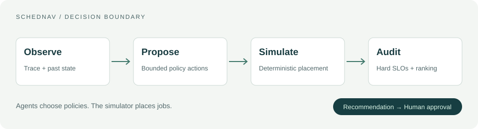

<p align="center"></p>

<h1 align="center">SchedNav</h1>
<p align="center"><strong>让 GPU 调度建议经得起仿真与审计。</strong></p>
<p align="center">Trace-driven simulation · Bounded agent decisions · Auditable evidence</p>
<p align="center">
  <a href="https://github.com/Hai-qq/SchedNav/actions/workflows/ci.yml"></a>
  <a href="LICENSE"></a>
  <a href="pyproject.toml"></a>
</p>
<p align="center"><a href="#快速体验">快速体验</a> · <a href="docs/README.md">文档</a> · <a href="docs/research-results.md">研究证据</a> · <a href="CONTRIBUTING.md">参与贡献</a> · <a href="https://github.com/Hai-qq/SchedNav/issues/new/choose">反馈问题</a></p>

---

SchedNav 是面向 GPU 集群调度研究的开源控制平面：把历史任务记录转换成统一 Trace，让 Agent 或规则提出有限的高层策略，由第一方确定性仿真器执行，再用硬 SLO（服务等级约束）审核结果。

**当前处于研究阶段。** 已实现离线反事实实验和只读取过去信息的滚动 shadow replay；尚未接入真实集群。公开证据没有证明预测控制或多 Agent 优于普通 FIFO（先到先服务）。



## 可以用它做什么

| 任务 | SchedNav 提供 |
|---|---|
| 比较 GPU 调度策略 | 在相同 Trace 和初始状态上运行 FIFO、抢占与保障策略，输出带指纹的指标和事件账本。 |
| 研究预测式资源预留 | 按租户和 GPU 资源池预测 HP（高优先级任务）需求，为 Spot（可抢占任务）生成配额。 |
| 评估 Agent 决策 | 限制动作空间，隐藏未来到达，保留连续仿真状态；可比较规则、单 Agent 与多 Agent。 |
| 审核建议是否成立 | 先检查硬 SLO，再按声明的指标排序；保留并列、无合格策略和待人工批准的结果。 |

Agent 不能选择具体 Job、Node 或 GPU，也不能通过 bridge 执行任意 shell。任务放置、抢占和资源核算由 simulator 完成。核心仿真无需 GPU、模型服务或第三方 Python 运行依赖；可训练预测器与 AgentTeams 是可选扩展。

## 快速体验

需要 **Python 3.11+** 和 Git。以下步骤从源码安装开发版本，使用合成任务运行 FIFO 与抢占对照；不下载数据、不调用模型。

```sh
git clone https://github.com/Hai-qq/SchedNav.git
cd SchedNav
python3 -m venv .venv
source .venv/bin/activate
python -m pip install -e .
python examples/quickstart.py
```

Windows PowerShell 将创建和激活环境两行替换为：

```powershell
py -3.11 -m venv .venv
.\.venv\Scripts\Activate.ps1
```

样例会打印两种策略的 HP 排队时间、抢占次数和结果指纹。它使用临时目录，并在退出时清理生成数据。**合成样例只展示机制，不代表真实集群收益。**

```sh
schednav --help
python -m unittest discover -s tests -v
python scripts/check_public_boundary.py
```

核心测试不需要模型服务；未安装 `forecast` 时，依赖 PyTorch 的测试会明确跳过。可选安装：`python -m pip install -e ".[forecast]"`。完整数据转换、预测与多窗口命令见[运行与复现](docs/usage.md)。

## 能力与边界

- **仿真内核**：异构 GPU、fractional GPU demand（小数卡资源需求）、确定性 best-fit placement、抢占、checkpoint rollback、保障周期与事件账本。
- **数据合同**：Alibaba Spot GPU、Alibaba GPU v2023 与 Microsoft Philly 适配器；外部数据也可转换为统一 Trace。Philly 缺少原生 HP/Spot 标签，需要显式记录映射。
- **预测与滚动控制**：历史截止点约束、需求预测、Spot 配额、状态交接、有界候选评估与冻结动作。
- **AgentTeams 集成**：1 Manager + 4 Worker，通过白名单 bridge 访问结构化操作。模型配置为 `deepseek-v4-flash`；使用该扩展需自行配置外部运行环境。

尚未实现真实集群 adapter、在线部署、拓扑/网络/CPU/故障建模、持久恢复或 actuator rollback。不引入 RL，也不把历史仿真成功等同于生产可用。

## 证据告诉了我们什么

仓库保留版本化汇总回执，原始 Trace 与逐 Job 结果不随仓库分发。以下是已有研究的公开记录，本次首页整理没有重新运行真实数据实验。

| 研究 | 公开结果 | 阅读入口 |
|---|---|---|
| 多数据集验证 | 验证数据转换、仿真与确定性；Philly 不覆盖 HP/Spot SLO。 | [数据与证据](docs/research-results.md) |
| 预测控制，11 窗口 | 5 个 holdout 窗口中，FIFO / guarded-static 通过 5/5，tenant-predictive 通过 1/5。 | [预测回执](evidence/predictive-v2/alibaba-gpu-series-2-predictive-multiwindow-v1.json) |
| 滚动控制 v3，5 窗口 | FIFO 通过 5/5，完整多 Agent 通过 3/5；匹配预算下遮蔽 Analyst 的对照通过 4/5。 | [滚动回执](evidence/rolling-v3/alibaba-gpu-series-2-rolling-ablation-v3.json) |

滚动 v3 属于探索性匹配对照：非 Agent holdout 结果曾在提示词冻结前可见，不能表述为完全盲化的因果证明。各代研究绑定自己的 Trace、窗口和 implementation fingerprint，不混合排名，也不据此宣称多 Agent 性能优势。完整方法、静态候选搜索研究及各代结果见[研究结果](docs/research-results.md)与[滚动控制](docs/rolling-control.md)。

## 文档导航

| 从哪里开始 | 文档 |
|---|---|
| 接入自己的数据 | [Trace Contract](docs/trace-contract.md) · [数据集与许可](docs/datasets.md) |
| 理解模拟与评价 | [仿真器](docs/native-simulator.md) · [SLO 定义](docs/schednav-demo-slo-v1.md) |
| 研究预测与 Agent | [预测控制](docs/predictive-control.md) · [滚动控制](docs/rolling-control.md) · [AgentTeams](docs/agentteams-integration.md) |
| 复现实验设计 | [多窗口评价](docs/multiwindow-evaluation.md) · [自适应 holdout](docs/adaptive-holdout-evaluation.md) |

## 项目结构

```text
src/schednav/    第一方仿真、数据合同、预测、审计和 bridge
configs/        策略、动作空间、SLO、控制器与冻结研究配置
schemas/        版本化 JSON Schema
examples/       无需外部数据的合成样例
scripts/        实验编排、证据发布与公开边界检查
tests/         单元、确定性、安全和合同测试
docs/          使用方法、模型语义与研究边界
evidence/      不含原始 Trace 的公开汇总回执
integrations/  AgentTeams 角色与资源模板
```

## 参与项目

欢迎提交可复现的 bug、数据适配器、合同测试与文档改进。开始前阅读[贡献指南](CONTRIBUTING.md)、[行为准则](CODE_OF_CONDUCT.md)与[安全政策](SECURITY.md)。涉及指标或数据语义的改动需要同步说明实验边界，不能只提交一个改善后的数字。

当前按源码分发开发版本；不承诺生产支持或响应时限。变更记录见 [CHANGELOG](CHANGELOG.md)。

## 许可证

第一方代码、文档与原创图形采用 [MIT](LICENSE)。数据集、AgentTeams 和兼容补丁遵循各自条款，详见[第三方声明](THIRD_PARTY_NOTICES.md)。仓库不分发原始数据集、外部运行环境或凭据。
